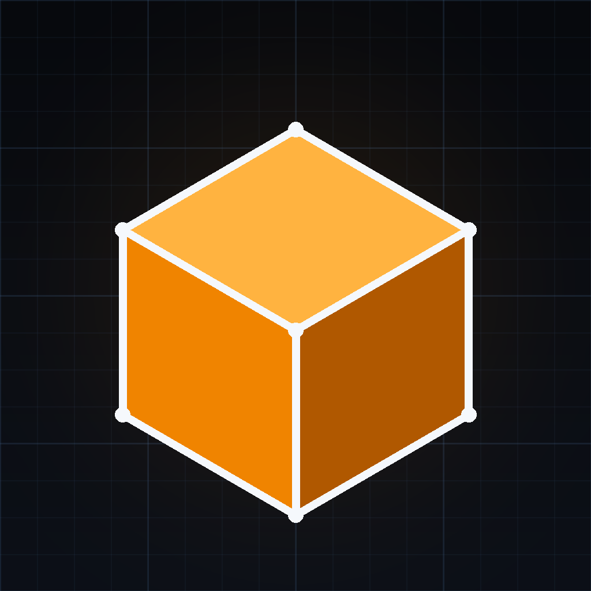

  

<h1 align="center">MetalCAD</h1>

  <b>A real parametric CAD app for iPad</b> — sketch with constraints, build features, tap faces and edges to modify them, and export for printing. Designed from the ground up for touch, large type, and high contrast.

  
  
  
  

---

## What it does

### Sketch
- Full 2D sketcher: lines, circles, arcs, points — with a real **constraint solver** (16 constraint types, degrees-of-freedom counting, drag editing with snapping)
- Sketches live on base planes, **datum planes**, or **any flat face of the model**
- Measure tool, dimension readouts, and constraint-driven parametric edits

### Model
- **Extrude** (join / cut / intersect / new body, taper, symmetric, two-sided, through-all, up-to-face), **Revolve**, **Loft**, **Sweep**, **Coil**, **Pipe**, **Rib**
- **Hole** wizard — simple, counterbore, countersink; holes sketched as circles drill at the circle's own size
- **Modeled threads** — thread a shaft you tap on the model, or a standalone threaded rod (metric / UNC / NPT presets, all parameters editable)
- **Fillet & chamfer** on whole features or on individual picked edges, with automatic max-feasible sizing
- Shell, draft, mirror, linear & circular patterns, split / move / scale body, primitives
- Real CSG booleans on a deterministic BSP kernel — watertight STL export

### Work the Fusion way
- **Tap the model**: pick a face, edge, shaft, or hole wall and get the actions that make sense for it — pull/press a face with a live slider, sketch on it, thread a shaft, fillet its edges
- **Live previews**: every panel drafts its result in real time as you scrub — the preview *is* the part, tinted, until you commit
- Selection-driven tools prefill from the **actual measured geometry** of what you tapped — never a preset guess
- Drag-resizable browser panel, rename anything, sketch & feature history with suppression and per-feature status

### Engineering
- 12 materials with density → live **volume, mass, and size** readouts
- Section views, quick two-point measure with persistent readout
- Save as native `.metaldoc`, export **STL** (binary, print-ready) or **OBJ**
- Accent color themes the whole app — buttons, highlights, sketch glow, measure markers

### Trust
- Every failure carries a **distinct, stable error code** (`MCAD-FT408`, `MCAD-SV302`, …) — see [ERRORS.md](ERRORS.md)
- **Structured logging** throughout, with an in-app Diagnostics screen — see [LOGGING.md](LOGGING.md)
- Full design document: [DESIGN.md](DESIGN.md)

## Install

MetalCAD ships as an unsigned IPA (GitHub Actions artifact, and attached to Releases):

1. Download `MetalCAD-unsigned.ipa` from the latest Release
2. Sign and install with **Signulous** (or your preferred sideloading service)
3. Requires an iPad running iPadOS 17 or later

## Building

- `MetalCADKit/` — the platform-pure Swift kernel (geometry, CSG, solver, features, IO). Fully unit-tested: `cd MetalCADKit && swift test`
- `App/` — the SwiftUI + SceneKit app. The Xcode project is generated: `cd App && python3 gen_project.py`
- CI (GitHub Actions, `macos-26`) runs the kit tests and packages the unsigned IPA on every push

## Version 1.12

- UI overhaul: sketch directly in the 3D viewport (drag tools, Pencil Pro hover, color-tinted grid) — no separate 2D sketch window; new documents open straight into a sketch
- Left tool rail replaces the top ribbon; constraints + measurement inspector live in the rail while sketching
- Smooth CAD look: area-weighted shading (crease 60°) + sharp-edge line overlay (Settings toggle)

## Version 1.11

- Layout: Export STL header button removed; the document name lives in the header bar and the empty black band above it is gone
- Sketch-plane picker in color: YZ red, XZ green, XY blue — glowing planes in the 3D view with matching picker cards
- Buttons: one background only — colored buttons no longer sit inside a grey box
- Performance: mesh bounds/volume cached at build time (instant readouts), boolean cap raised to 300k triangles, fast STL/OBJ IO — headroom to ~1M-triangle parts

## Version 1.10

- Fixed: header buttons crushed by layout — chips now size to their labels and never wrap
- Fixed: browser-panel drag stutter (the width is now committed once per drag, not saved per pixel)
- New: app icon
- Carries forward the v4.8/4.9 work: preview-replaces-model live drafting, sticky per-document camera, blank documents, rename, Save As (.metaldoc / STL / OBJ), accent color in Home ▸ Settings, and the editor-open crash fix

---

Built with Muse.
